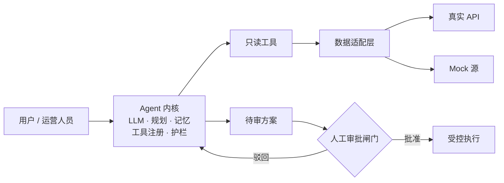

<h1>你好，我是 Keith</h1>

同济大学软件工程本科生，方向偏工程实现的 AI 研究与全栈开发。 
做 Agent 系统、LLM 应用层和底层系统软件——并且尽量让每一件都成为<b>能跑、能查</b>的东西，而不是一页幻灯片。

  
  
  

  <a href="#-在做的事">在做的事</a> ·
  <a href="#-工具链">工具链</a> ·
  <a href="#-项目">项目</a> ·
  <a href="#-设计立场">设计立场</a> ·
  <a href="#-联系">联系</a>

## 🎯 在做的事

| 方向 | 这个账号里真实存在的东西 |
|:--|:--|
| **多 Agent 编排** | LangGraph 上五个角色子图、语法完整；每工作区一个 Docker 沙箱、双人工审批闸门——**只有 README，没有源码** → `multi_agent_coder` |
| **Agent 系统设计** | 一个权限边界显式、带人工审批闸门的智能体平台——设计阶段，无代码 → `CitySense_Agent` |
| **LLM 应用层** | 模型无关的生成管道，按请求路由 Key 并做 SSRF 过滤 → `Jade_realm`；把生成锚定在版本化数据资产上的选题引擎 → `Tuomato`（仅设计） |
| **开发者工具 / HCI** | 建立在本地语法事实而非自由生成之上的 IDE 学习 Agent——MVP 设计阶段 → `Programming-Assisted-Learning-...-Plugin` |
| **iOS / Android 客户端** | Flutter + Riverpod + Isar，服务端 SM-2 调度、设计 Token 热更新 → `For408`（骨架，从未编译） |
| **系统基础** | 1 MB 虚拟磁盘上的类 FAT 文件系统，24 项断言通过；MIT 6.S081 全部 10 个 xv6 Lab → `FAT-like-File-System-Simulator`、`xv6-Labs-2021-MIT` |
| **全栈交付** | Vue 3 + ASP.NET Core 8 + Oracle，编号迁移 + 容器化发布流水线 → `dormitory-service-platform` |

**说过但还没发布：** 推理引擎（vLLM / SGLang）、加速器算子、边缘 AI 与医疗机器人闭环。这些**没有对应仓库**，本页任何内容都不应被读成「已经做了」。

## 🛠️ 工具链

<h3 align="center">大模型与 Agent</h3>

  
  
  
  
  
  

<h3 align="center">推理与加速</h3>

  
  
  

页表与写时复制 · 自旋锁 / 缓冲区竞争 · 虚拟磁盘块分配。尚无推理引擎或内核算子仓库——这是当前的地基。

<h3 align="center">全栈开发</h3>

  
  
  
  
  
  
  

  
  
  
  
  
  

<h3 align="center">HCI / 边缘与硬件</h3>

  
  
  
  
  
  

边缘设备与硬件在环的工作属于计划，尚未发布。

## 📦 项目

九个公开仓库（本主页仓库不计）。顺序：设计构想 → Agent 系统 → 系统基础 → 课程作业。
标签表示成熟度，不表示质量。

`⭐` 重点 · `📝` 研究原型 · `🔧` 实用工具 · `🧪` 演示

### ⭐ 📝 [CitySense_Agent](https://github.com/Keith-hq/CitySense_Agent) · 设计阶段

面向城市运营与市民服务的智能体平台。汇聚交通、环境、公共资源数据，让 LLM 驱动的 Agent 监测城市状态、跨域调查异常、提出处置建议——而任何有现实影响的动作都留在人工审批闸门之后。

- **问题**：市政数据分散在互不相通的系统里，「监控大屏」模式把关联与根因推理全留给人。
- **技术**：LLM 内核 + 规划器 / 记忆 / 工具注册 / 护栏；数据适配层隔离真实公共 API 与 Mock 源；逐动作审计日志；调用第三方模型前做 PII 脱敏。
- **状态**：依据 SRS 定义了范围与 12 个用例。**未提交任何源码**——仓库描述的是目标系统，不是已交付的行为。

### ⭐ 📝 [multi_agent_coder](https://github.com/Keith-hq/multi_agent_coder) · 设计阶段

一个 Web 端编码助手，把一条需求走完「规划 → 编码 → 测试 → 评审 → 文档」，LangGraph 主图路由到五个角色子图。角色是**配置**（模型、提示词、工具白名单、发言权重），不是代码——加第六个角色只需加一个配置文件，不用动图。

- **问题**：自主编码 Agent 容易演示、难以审计。难的不是生成，是**约束**：谁能执行什么、在哪个目录、花多少预算。
- **技术**：LangGraph 1.2 checkpointer（可续跑、审批挂起）· FastAPI + SSE · 一工作区一 Docker 容器（非 root、丢 capabilities、只读根文件系统、默认断网）· MCP 工具服务 · SQLite 存配置元数据、PostgreSQL 存状态与事件流。
- **状态**：架构、安全模型与四阶段计划已成文。**未提交任何源码**——这是一份设计文档。

### 🧪 [Jade_realm](https://github.com/Keith-hq/Jade_realm) · 可用

中国玉文化交互体验：选器物、玉材、朝代、纹饰与工艺拼出生图提示词；在 Leaflet 时间轴上追三条玉料路线，从公元前 2000 年到 1800 年；把一句成语变成带 AI 配图与二维码导出的分享卡片。

- **问题**：一条多步文化设计流程，且不内置任何凭证——用户没有 Key 时，整条流程必须优雅降级。
- **技术**：React 18 · Vite 5 · Tailwind · Leaflet · FastAPI · 任意 OpenAI 兼容端点 + SiliconFlow 生图；按请求下发 Key，三级优先级解析（页面设置 → `.env` → 进程环境变量），对调用方提供的 Base URL 做 SSRF 过滤。
- **状态**：一个仓库两代实现——组件化 React 应用 + 单文件 HTML 版（自带静态托管后端）。

### 🔧 [For408](https://github.com/Keith-hq/For408) · 骨架，从未编译

面向 408 四大科目的间隔重复背诵应用，三端：Flutter 客户端、Spring Boot API、Vue 运营后台。卡片正反面回忆、SM-2 调度、多题型、统一「待强化」池。

- **问题**：复习调度是上线后唯一改不动的决策——放在客户端，每台设备都会算出不同计划。它放在服务端，作为唯一事实来源。
- **技术**：Flutter 3.24 · Riverpod 2.5 · Isar 3.1（离线优先：先写本地、标 `pendingSync`、再推送）· Java 21 · Spring Boot 3.3.4 · Gradle 多模块 · MySQL 8 · Flyway · Vue 3 + Element Plus；设计 Token 与内容包可热更新，AOT 编译的 UI 不行。
- **状态**：目录、模块边界、9 张表、JWT 双身份鉴权、SM-2 引擎、10 组 REST 接口已就位。**从未在作者机器上构建过**——那台机器没有 JDK、Gradle 和 Flutter SDK。OAuth、短信、图片上传仍是桩。

### 🔧 [dormitory-service-platform](https://github.com/Keith-hq/dormitory-service-platform) · 源码完整，线上已下线

高校宿舍后勤与共享生活平台：住宿、资产、账单、水电分摊、维修派单与 SLA 升级、共享物品借用、访客二维码、退宿清算。

- **问题**：宿舍运营散在纸质台账里——把完整生命周期（入住 → 计费 → 维修 → 退宿）收进一个服务，状态迁移可审计。
- **技术**：Vue 3 · Vite · Pinia · ASP.NET Core .NET 8 · EF Core · Quartz.NET · Oracle XE 21（编号迁移 + 存储过程）· Docker Compose · Nginx · GitHub Actions 推 GHCR 镜像。
- **状态**：源码与部署资产完整保留。原云服务器已到期，线上**当前不可访问**；重新部署步骤写在 README 里。

### 🔧 [FAT-like-File-System-Simulator](https://github.com/Keith-hq/FAT-like-File-System-Simulator) · 完成

在 1 MB 虚拟磁盘上从零字节建起的类 FAT 文件系统：超级块、FAT 表、位图、多级目录、跨块读写、原子化映像持久化。不碰宿主文件系统 API——所有状态都在自管理的 `bytearray` 和单个 `.img` 文件里。

- **问题**：让「文件系统如何把字节变成文件」变得可观察、可验证，GUI 与 22 条命令的 CLI 共用一套引擎。
- **技术**：Python 3.13 · PyQt6 · `struct` 打包的 153 字节目录项 · 显式 FAT 链分配与位图交叉校验 · 原子保存（临时文件 → `.bak` → 替换）。
- **状态**：24 项端到端断言通过。已知限制写在 README 里：单线程、无权限模型、无链接与挂载点。

### 📝 [Programming-Assisted-Learning-AI-Agent-VS-Code-Plugin](https://github.com/Keith-hq/Programming-Assisted-Learning-AI-Agent-VS-Code-Plugin) · MVP 设计阶段

一个**刻意不替你写代码**的 VS Code 学习 Agent。它讲解代码：先原理、再执行流程、最后易错点——每条结论都锚定到一个能点回去的行号。

- **问题**：生成工具会磨掉调试肌肉。解药不是更好的提示词，而是把模型钉在它编不出来的事实上。
- **技术**：扩展宿主上的 TypeScript · web-tree-sitter（WASM）本地语法树 · LSP 提供类型与引用事实 · 语义检索补跨文件片段 · SQLite 存在 `globalStorageUri`——用户项目目录在设计上只读。
- **状态**：架构与一套评测协议（50 段代码、单盲 A/B、3 名评分者、结论无论正负都公开）已成文。**未提交插件代码**。

### 📝 [Tuomato](https://github.com/Keith-hq/Tuomato) · 设计阶段

面向求职准备的计算机学生项目选题引擎。它不让模型凭空发明项目，而是先检索目标岗位的技能画像，再把生成约束到画像上——于是产出质量取决于一份版本化数据资产的质量，而不是模型今天心情好不好。

- **问题**：「给我做个后台 CRUD 项目」就是失败模式。学生缺的恰恰是那件最重要的事：招聘方现在到底看什么。
- **技术**：FastAPI · Vue 3 · MySQL 8 全文 / ngram 召回 · DeepSeek API · 用 Pydantic 把九字段输出定成契约 · 三条合规红线（不存原文、不分发原文、不绕过限制）· 刻意选择模块化单体。
- **状态**：只有设计文档。**未提交业务代码**——README 一开头就写明这点，不把计划装扮成进展。

### 📝 [xv6-Labs-2021-MIT](https://github.com/Keith-hq/xv6-Labs-2021-MIT) · 课程作业，完成

MIT 6.S081（2021）全部 10 个 Lab，跑在 RISC-V xv6 教学内核上，一 Lab 一分支，各自可独立构建：用户程序、系统调用、页表、中断、写时复制 fork、用户级线程、E1000 网卡驱动（UDP/IP）、锁竞争、文件系统（大文件、符号链接、inode 日志）、mmap。

- **问题**：为「推理运行时脚下那层内核机制」建立扎实直觉——页表、COW、阻塞、缓冲区锁。
- **技术**：C · RISC-V 汇编 · QEMU · xv6 内核树。
- **状态**：完成；每个分支自带 `grade-lab-*` 脚本。

## 🧭 设计立场

两个 Agent 项目都把模型关在密封边界内，让 Agent 的**权限比它的知识更窄**。下图出自 `CitySense_Agent` 自己的规格说明。

## 📊 GitHub 统计

## 🔬 研究与学习进展

留给论文、实验和升学进展。在真有东西可写之前，故意留空。

| 日期 | 事项 | 状态 |
|:--|:--|:--|
| — | _暂无公开投稿或实验报告_ | — |

计划中的方向，按「计划」而非「成果」陈述：

- AI / HCI 方向升学准备——进行中，无可报告的结果
- CCF 会议投稿规划——尚未投稿，无可引用内容
- 推理引擎与加速器算子实验（vLLM、SGLang、国产 AI 加速器）——有代码时才开仓库
- 边缘 AI / 医疗机器人闭环原型——概念阶段

## 📬 联系

  
  

- `2451914@tongji.edu.cn` —— 直接邮件，研究或合作优先走这里
- [全部仓库](https://github.com/Keith-hq?tab=repositories) —— 权威列表，本页只是镜像
- 上面任何一个仓库的 Issue 我都会看
- `dormitory-service-platform` 与 `Jade_realm` 都带完整本地运行说明，这两件事上**复现比提问快**

 

9 个公开仓库 · 以上每一条陈述都来自仓库元数据与 README · 更新于 2026-10-21

