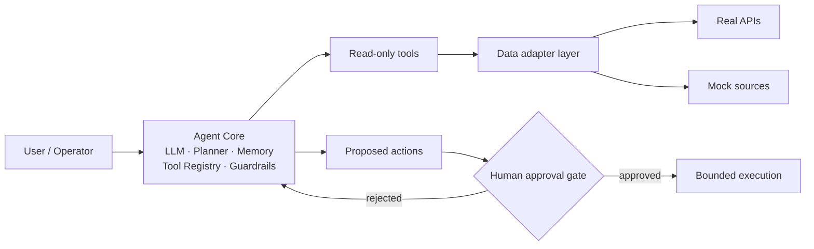

<picture>
  <source media="(prefers-color-scheme: dark)" srcset="assets/banner-dark.svg?v=3">
  <source media="(prefers-color-scheme: light)" srcset="assets/banner-light.svg?v=3">
  
</picture>

Undergraduate in Software Engineering at Tongji University, working as an engineering-oriented AI researcher and full-stack developer. I build agent systems, LLM application layers, and low-level systems software — and try to make each one a running, inspectable artifact rather than a slide.

## Focus

| Direction | What actually exists in this account |
| :--- | :--- |
| **Multi-agent orchestration** | Syntax fully typed, five role subgraphs on LangGraph, per-workspace Docker sandbox with dual human-approval gates — README only, no source yet → `multi_agent_coder` |
| **Agent system design** | An agentic platform with explicit permission boundaries and a human-approval gate — design stage, no code yet → `CitySense_Agent` |
| **LLM application layer** | A model-agnostic generation pipeline with per-request key routing and SSRF filtering → `Jade_realm`; a profile-constrained planner that pins generation to a versioned data asset → `Tuomato` (design only) |
| **Developer tooling / HCI** | An IDE-embedded learning agent built on local syntax facts rather than free-running generation — MVP design stage → `Programming-Assisted-Learning-...-Plugin` |
| **iOS / Android client** | Flutter + Riverpod + Isar client with server-side SM-2 scheduling and hot-updatable design tokens → `For408` (skeleton, never compiled) |
| **Systems fundamentals** | A FAT-like file system on a 1 MB virtual disk with 24 passing assertions; all 10 MIT 6.S081 xv6 labs → `FAT-like-File-System-Simulator`, `xv6-Labs-2021-MIT` |
| **Full-stack delivery** | Vue 3 + ASP.NET Core 8 + Oracle with numbered migrations and a containerized release pipeline → `dormitory-service-platform` |

**Stated but not yet published:** inference-engine work (vLLM / SGLang), accelerator operators, edge-AI and medical-robot closed loops. No repository exists for these. Nothing on this page should be read as a claim that one does.

## Toolchain

**Large Language Model & Agent**

**Inference & Acceleration**

_Page tables & copy-on-write · spinlock / buffer-cache contention · virtual-disk block allocation. No inference-engine or kernel-operator repository published yet — this is the current base._

**Full-Stack Development**

**HCI / Edge & Hardware AI**

_Edge-device and hardware-in-the-loop work is planned, not published._

## Selected Projects

Nine public repositories (this profile repo excluded). Order: design concepts → agent systems → systems foundation → coursework. Tags classify maturity, not quality.

`⭐` highlight · `📝` research prototype · `🔧` utility tool · `🧪` demo

### ⭐ 📝 [CitySense_Agent](https://github.com/Keith-hq/CitySense_Agent) · design stage

An agentic platform for urban operations and citizen services. Consolidates traffic, environmental, and public-resource data so an LLM-driven agent can monitor city state, investigate anomalies across domains, and propose remediation — while any action with real-world effect stays behind a human approval gate.

- **Problem:** municipal data sits in disconnected systems, and the current "monitoring dashboard" model leaves correlation and root-cause reasoning to human operators.
- **Tech:** LLM core with planner / memory / tool-registry / guardrail layers; a data-adapter layer isolating real public APIs from mock sources; per-action audit log; PII masking before third-party model calls.
- **Status:** scope and 12 use cases defined from an SRS. **No source code committed** — the repository describes a target system, not shipped behavior.

### ⭐ 📝 [multi_agent_coder](https://github.com/Keith-hq/multi_agent_coder) · design stage

A web-based coding assistant that walks one requirement through plan → code → test → review → docs, as a LangGraph main graph routing to five role subgraphs. Roles are configuration (model, prompt, tool allowlist, speaking weight), not code — adding a sixth one means adding a config file, not touching the graph.

- **Problem:** autonomous coding agents are easy to demo and hard to audit — the hard part is not generation, it is containment: who may run what, in which directory, under which budget.
- **Tech:** LangGraph 1.2 checkpointer (resumable runs, approval suspension) · FastAPI + SSE · one Docker container per workspace (non-root, dropped capabilities, read-only rootfs, network off by default) · MCP tool servers · SQLite for config metadata, PostgreSQL for state and event log.
- **Status:** architecture, security model, and a four-phase plan are written. **No source code committed** — this is a design document.

### 🧪 [Jade_realm](https://github.com/Keith-hq/Jade_realm) · usable

An interactive Chinese jade-culture experience: pick vessel, material, dynasty, motif, and craft to assemble a generation prompt; trace three jade-material routes across a Leaflet timeline from 2000 BC to 1800 AD; turn an idiom into a shareable card with AI illustration and QR export.

- **Problem:** a multi-step cultural design workflow with no bundled credentials — the whole flow has to degrade gracefully when the user has no model key.
- **Tech:** React 18 · Vite 5 · Tailwind · Leaflet · FastAPI · any OpenAI-compatible endpoint + SiliconFlow image generation; per-request key headers with tiered resolution (page settings → `.env` → process env), SSRF filtering on caller-supplied base URLs.
- **Status:** two generations in one repo — a componentized React app and a single-file HTML build with self-hosted static backend.

### 🔧 [For408](https://github.com/Keith-hq/For408) · skeleton, never compiled

A spaced-repetition review app for the four core CS graduate-exam subjects, across three ends: Flutter client, Spring Boot API, Vue operations console. Card front/back recall, SM-2 scheduling, multiple question types, and a unified "needs reinforcement" pool.

- **Problem:** review scheduling is the one decision that cannot be changed after launch — put it on the client and every device drifts to a different plan. It lives on the server as the single source of truth.
- **Tech:** Flutter 3.24 · Riverpod 2.5 · Isar 3.1 (offline-first: write locally, mark `pendingSync`, then push) · Java 21 · Spring Boot 3.3.4 · Gradle multi-module · MySQL 8 · Flyway · Vue 3 + Element Plus; design tokens and content bundles hot-updated, AOT-compiled UI does not.
- **Status:** directories, module boundaries, 9 tables, JWT dual-audience auth, the SM-2 engine, and 10 REST groups are in place. **Never built on the author's machine** — no JDK, Gradle, or Flutter SDK there. OAuth, SMS, and image upload are still stubs.

### 🔧 [dormitory-service-platform](https://github.com/Keith-hq/dormitory-service-platform) · source complete, live site offline

A university dormitory logistics and shared-living platform: accommodation, assets, billing, water/electricity apportionment, repair dispatch with SLA escalation, shared-item lending, visitor QR codes, checkout settlement.

- **Problem:** dormitory operations scattered across manual ledgers — consolidates the full life cycle (occupancy → billing → maintenance → checkout) into one service with auditable state transitions.
- **Tech:** Vue 3 · Vite · Pinia · ASP.NET Core .NET 8 · EF Core · Quartz.NET · Oracle XE 21 with numbered migrations and stored procedures · Docker Compose · Nginx · GHCR images via GitHub Actions.
- **Status:** full source and deployment assets retained. The original cloud server has expired, so the live site is **currently offline**; redeploy steps are documented in the README.

### 🔧 [FAT-like-File-System-Simulator](https://github.com/Keith-hq/FAT-like-File-System-Simulator) · complete

A FAT-like file system built from zero bytes on a 1 MB virtual disk: superblock, FAT table, bitmap, multi-level directories, cross-block read/write, atomic image persistence. No host file-system API involved — all state lives in a self-managed `bytearray` and a single `.img` file.

- **Problem:** making the mechanics of "how a file system turns bytes into files" inspectable and testable, with a GUI and a 22-command CLI sharing one engine.
- **Tech:** Python 3.13 · PyQt6 · `struct`-packed 153-byte directory entries · explicit FAT chain allocation cross-checked against a bitmap · atomic save (temp → `.bak` → replace).
- **Status:** 24 end-to-end assertions passing. Known limits stated in the README: single-threaded, no permission model, no links or mount points.

### 📝 [Programming-Assisted-Learning-AI-Agent-VS-Code-Plugin](https://github.com/Keith-hq/Programming-Assisted-Learning-AI-Agent-VS-Code-Plugin) · MVP design stage

A VS Code learning agent that deliberately does not write your code. It explains it: principle first, then execution flow, then the pitfalls — each claim anchored to a line number you can click back to.

- **Problem:** generation tools erase the debugging muscle. The fix is not a better prompt; it is grounding the model in facts it cannot invent.
- **Tech:** TypeScript on the extension host · web-tree-sitter (WASM) for local syntax trees · LSP for type and reference facts · semantic retrieval for cross-file fragments · SQLite in `globalStorageUri` — the user's project directory is read-only by construction.
- **Status:** architecture and an evaluation protocol (50 code samples, single-blind A/B, three graders, results published whether positive or negative) are written. **No plugin code committed.**

### 📝 [Tuomato](https://github.com/Keith-hq/Tuomato) · design stage

A project-ideation engine for CS students preparing for job applications. Instead of asking a model to invent a project, it retrieves a skill profile for the target role and constrains generation to it — output quality then depends on the quality of a versioned data asset, not on how good the model feels today.

- **Problem:** "make me a backend CRUD project" is the failure mode. Students lack the one thing that matters: what hiring teams actually look for right now.
- **Tech:** FastAPI · Vue 3 · MySQL 8 with FULLTEXT/ngram recall · DeepSeek API · Pydantic as the contract for a fixed nine-field output · three-red-line compliance model (no original text stored, none redistributed, no access controls bypassed) · modular monolith on purpose.
- **Status:** design document only. **No business code committed** — the README states this up front and does not dress the plan as progress.

### 📝 [xv6-Labs-2021-MIT](https://github.com/Keith-hq/xv6-Labs-2021-MIT) · coursework, complete

All 10 MIT 6.S081 (2021) labs on the RISC-V xv6 teaching kernel, one branch per lab, each independently buildable: user programs, syscalls, page tables, traps, copy-on-write fork, user-level threads, E1000 network driver with UDP/IP, lock contention, file system (large files, symlinks, inode journaling), and mmap.

- **Problem:** building grounded intuition for the kernel mechanisms that inference runtimes sit on top of — page tables, COW, blocking, buffer-cache locking.
- **Tech:** C · RISC-V assembly · QEMU · xv6 kernel tree.
- **Status:** complete; each branch ships its own `grade-lab-*` script.

## Design Stance

Both agent projects keep the model behind a sealed boundary and the agent's authority narrower than its knowledge. Diagram below is from `CitySense_Agent`'s own specification.

## GitHub Stats

## Research / Study Updates

Reserved for papers, experiments, and graduate-application progress. Kept empty on purpose until there is something real to record.

| Date | Item | Status |
| :--- | :--- | :--- |
| — | _No public paper submission or experiment report yet._ | — |

Planned directions, stated as plans rather than results:

- AI / HCI graduate study preparation — in progress, no outcome to report.
- CCF-venue submission planning — nothing submitted, nothing to cite.
- Inference-engine and accelerator-operator experiments (vLLM, SGLang, domestic AI accelerators) — will be published as repositories when there is code.
- Edge-AI / medical-robot closed-loop prototype — concept stage.

## Contact

- `2451914@tongji.edu.cn` — direct mail, preferred for research or collaboration.
- [All repositories](https://github.com/Keith-hq?tab=repositories) — the authoritative list; this page mirrors it.
- Issues on any repository above are also read.
- `dormitory-service-platform` and `Jade_realm` both carry full local-run instructions. Reproduction beats questions for those two.

 

9 public repositories · every claim above is derived from repository metadata and READMEs · updated 2026-10-21

