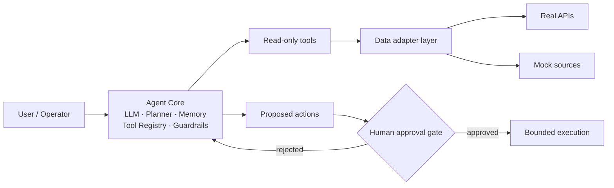

# Keith-hq

**Engineering-oriented AI researcher and full-stack developer.**
Working on agent system design, LLM/VLM application layers, inference & operator-level acceleration, and HCI prototypes — each of them delivered as a running, inspectable artifact rather than a slide.

---

## Focus

| 方向 | 当前实际产出 |
| :--- | :--- |
| LLM Agent system design | Requirement-level agent architecture with explicit permission boundaries and human-in-the-loop gates (`CitySense_Agent`) |
| LLM application layer | Model-agnostic generation pipeline with BYOK key routing and graceful degradation (`Jade_realm`) |
| Systems & operating systems | File system internals on a virtual disk; xv6 kernel labs on RISC-V (`FAT-like-File-System-Simulator`, `xv6-Labs-2021-MIT`) |
| Full-stack engineering | Vue 3 + ASP.NET Core + Oracle release pipeline with containerized, reproducible deployment (`dormitory-service-platform`) |

> Inference engines (vLLM / SGLang), accelerator operators, and closed-loop medical / edge hardware prototypes are ongoing research directions. **No public repository for them yet — nothing on this page claims otherwise.**

---

## Toolchain

**Large Language Model & Agent**
`Python` · `FastAPI` · `OpenAI-compatible APIs` · `SiliconFlow` · `prompt pipeline design` · `agent planning / tool registry / guardrails`

**Inference & Acceleration**
`systems-level performance reasoning` · `OS-level concurrency & locking` · `memory & page-table mechanics`
_No public inference-engine or operator repository yet._

**Full-Stack Development**
`TypeScript` · `React` · `Vue 3` · `Vite` · `Pinia` · `C# / ASP.NET Core .NET 8` · `EF Core` · `Oracle` · `Docker Compose` · `Nginx` · `GitHub Actions` · `PyQt6`

**HCI / Edge & Hardware AI**
`interactive web prototypes` · `map & timeline visualization` · `generated-content export (PNG / QR)`
_Edge-device and hardware-loop work is planned, not yet published._

---

## Selected Projects

Five public repositories at present. Ordered by research proximity first, engineering depth second, coursework last. Every description below is taken from the repository's own README; maturity is stated explicitly.

### 1. CitySense_Agent · `📝 Research Prototype` · **design stage**

An agentic platform concept for urban operations and citizen services: it consolidates traffic, environmental, and public-resource data, then lets an LLM-driven agent monitor, investigate across domains, and propose remediation — with a hard boundary that any action with real-world effect must pass human approval.

- **Solves:** fragmented municipal data sources and a passive "monitoring dashboard" model that leaves correlation and root-cause reasoning to human operators.
- **Tech:** LLM core with planner / memory / tool registry / guardrail layers; data-adapter layer isolating real public APIs from mock sources; audit trail and PII masking before third-party model calls.
- **Status:** README defines scope and 12 use cases from an SRS. **No source code committed.** Described as target design, not implemented behavior.

### 2. Jade_realm · `🧪 Demo` · usable

An interactive Chinese jade-culture experience: pick vessel, material, dynasty, motif, and craft to assemble a generation prompt; trace three jade-material routes across a Leaflet timeline from 2000 BC to 1800 AD; turn an idiom into a shareable card with AI illustration and QR export.

- **Solves:** turning a multi-step cultural design workflow into a guided web flow with no bundled credentials — users supply their own model keys.
- **Tech:** React 18 · Vite 5 · Tailwind · Leaflet · FastAPI · any OpenAI-compatible endpoint + SiliconFlow image generation; per-request key headers with tiered fallback (page settings > `.env` > process env), SSRF filtering on caller-supplied base URLs.
- **Status:** two generations shipped in one repo — a componentized React app and a single-file HTML build with self-hosted static backend.

### 3. dormitory-service-platform · `🔧 Utility Tool` · production-shaped

A university dormitory logistics and shared-living platform covering accommodation, assets, billing, water/electricity apportionment, repair dispatch with SLA escalation, shared-item lending, visitor QR codes, and checkout settlement.

- **Solves:** dormitory operations scattered across manual ledgers — consolidates life-cycle state (occupancy → billing → maintenance → checkout) into one service with auditable state transitions.
- **Tech:** Vue 3 · Vite · Pinia · ASP.NET Core .NET 8 · EF Core · Quartz.NET · Oracle XE 21 (numbered migrations, stored procedures) · Docker Compose · Nginx · GHCR images via GitHub Actions.
- **Status:** complete source and deployment assets retained. The original cloud server has expired, so the live site is **currently offline**; redeploy steps are documented in the README.

### 4. FAT-like-File-System-Simulator · `🔧 Utility Tool` · complete

A FAT-like file system built from zero bytes on a 1 MB virtual disk: superblock, FAT table, bitmap, multi-level directories, cross-block read/write, atomic image persistence. No host file-system API involved — all state lives in a self-managed `bytearray` and a single `.img` file.

- **Solves:** making the mechanics of "how a file system turns bytes into files" inspectable and testable, with a GUI and a 22-command CLI sharing one engine.
- **Tech:** Python 3.13 · PyQt6 · `struct`-packed 153-byte directory entries · explicit FAT chain allocation plus bitmap cross-check · atomic save (temp → `.bak` → replace).
- **Status:** 24 end-to-end assertions passing. Known limits documented honestly: single-threaded, no permission model, no links or mount points.

### 5. xv6-Labs-2021-MIT · `📝 Research Prototype` · coursework, complete

All 10 MIT 6.S081 (2021) labs on the RISC-V xv6 teaching kernel, one branch per lab, each independently buildable: user programs, syscalls, page tables, traps, copy-on-write fork, user-level threads, E1000 network driver with UDP/IP, lock contention, file system (large files, symlinks, inode journaling), and mmap.

- **Solves:** building grounded intuition for the kernel mechanisms that inference engines and runtimes sit on top of — page tables, COW, futex-style blocking, buffer cache locking.
- **Tech:** C · RISC-V assembly · QEMU · xv6 kernel tree.
- **Status:** complete; each branch ships its `grade-lab-*` script.

---

## Architecture Notes

The two AI-side projects share one design stance: keep the model behind a sealed boundary, and keep the agent's authority narrower than its knowledge.

---

## GitHub Stats

---

## Research / Study Updates

Reserved for papers, experiments, and graduate-application progress. Kept empty on purpose until there is something real to record.

| Date | Item | Status |
| :--- | :--- | :--- |
| — | _No public paper submissions or experiment reports yet._ | — |

Planned directions, stated as plans rather than results:

- AI / HCI graduate study preparation — in progress, no outcome to report.
- CCF-venue submission planning — none submitted; nothing to cite.
- Inference-engine and accelerator-operator experiments (vLLM, SGLang, domestic AI accelerators) — to be published as repos when there is code.
- Edge-AI / medical-robot closed-loop prototype — concept stage.

---

## Contact

- GitHub issues on any repository above are the intended channel; they are read.
- `dormitory-service-platform` and `Jade_realm` both carry full local-run instructions — reproduction beats questions for these two.

---

Public repositories: 5 · Content on this page is derived only from repository metadata and READMEs, updated 2026-10-20.

