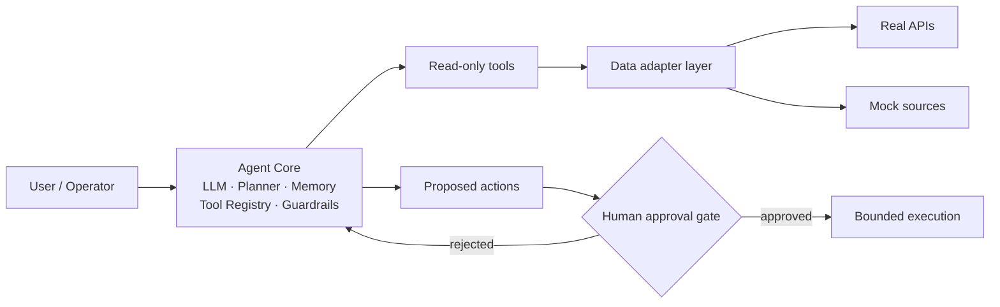

# Keith-hq

Engineering-oriented AI researcher / full-stack developer.
I build agent systems, LLM application layers, and low-level systems software — and try to make each one a running, inspectable artifact rather than a slide.

---

## Focus

| Direction | What actually exists in this account |
| :--- | :--- |
| **Agent system design** | An agentic platform design with explicit permission boundaries and a human-approval gate — requirements stage, no code yet → `CitySense_Agent` |
| **LLM application layer** | A model-agnostic generation pipeline with per-request key routing, SSRF filtering, and graceful degradation → `Jade_realm` |
| **Systems fundamentals** | A FAT-like file system built on a 1 MB virtual disk with 24 passing assertions; all 10 MIT 6.S081 xv6 labs → `FAT-like-File-System-Simulator`, `xv6-Labs-2021-MIT` |
| **Full-stack delivery** | Vue 3 + ASP.NET Core 8 + Oracle, with numbered DB migrations and a containerized release pipeline → `dormitory-service-platform` |

**Stated but not yet published:** inference-engine work (vLLM / SGLang), accelerator operators, edge-AI and medical-robot closed loops. No repository exists for these. Nothing on this page should be read as a claim that one does.

---

## Toolchain

**Large Language Model & Agent**
`Python` · `FastAPI` · `OpenAI-compatible chat/completions` · `SiliconFlow image generation` · `prompt-assembly pipelines` · `agent planning / tool registry / guardrails` · `BYOK key routing`

**Inference & Acceleration**
`C` · `RISC-V assembly` · `QEMU` · `page tables & copy-on-write` · `spinlock / buffer-cache contention` · `virtual-disk block allocation`
_No inference-engine or kernel-operator repository published yet. The systems work above is the current base._

**Full-Stack Development**
`TypeScript` · `React 18` · `Vue 3` · `Vite` · `Pinia` · `C# / ASP.NET Core .NET 8` · `EF Core` · `Quartz.NET` · `Oracle 21c` · `Docker Compose` · `Nginx` · `GitHub Actions` · `PyQt6`

**HCI / Edge & Hardware AI**
`interactive web prototypes` · `Leaflet map + timeline interfaces` · `in-browser card export (PNG / QR)` · `single-file offline builds`
_Edge-device and hardware-in-the-loop work is planned, not published._

---

## Selected Projects

Five public repositories. Order: research proximity → engineering depth → coursework. Tags classify maturity, not quality.

`⭐` highlight · `📝` research prototype · `🔧` utility tool · `🧪` demo

### ⭐ 📝 [CitySense_Agent](https://github.com/Keith-hq/CitySense_Agent) · design stage

An agentic platform for urban operations and citizen services. Consolidates traffic, environmental, and public-resource data so an LLM-driven agent can monitor city state, investigate anomalies across domains, and propose remediation — while any action with real-world effect stays behind a human approval gate.

- **Problem:** municipal data sits in disconnected systems, and the current "monitoring dashboard" model leaves correlation and root-cause reasoning to human operators.
- **Tech:** LLM core with planner / memory / tool-registry / guardrail layers; a data-adapter layer isolating real public APIs from mock sources; per-action audit log; PII masking before third-party model calls.
- **Status:** scope and 12 use cases defined from an SRS. **No source code committed** — the repository describes a target system, not shipped behavior.

### 🧪 [Jade_realm](https://github.com/Keith-hq/Jade_realm) · usable

An interactive Chinese jade-culture experience: pick vessel, material, dynasty, motif, and craft to assemble a generation prompt; trace three jade-material routes across a Leaflet timeline from 2000 BC to 1800 AD; turn an idiom into a shareable card with AI illustration and QR export.

- **Problem:** a multi-step cultural design workflow with no bundled credentials — the whole flow has to degrade gracefully when the user has no model key.
- **Tech:** React 18 · Vite 5 · Tailwind · Leaflet · FastAPI · any OpenAI-compatible endpoint + SiliconFlow image generation; per-request key headers with tiered resolution (page settings → `.env` → process env), SSRF filtering on caller-supplied base URLs.
- **Status:** two generations in one repo — a componentized React app and a single-file HTML build with self-hosted static backend.

### 🔧 [dormitory-service-platform](https://github.com/Keith-hq/dormitory-service-platform) · source complete, live site offline

A university dormitory logistics and shared-living platform: accommodation, assets, billing, water/electricity apportionment, repair dispatch with SLA escalation, shared-item lending, visitor QR codes, checkout settlement.

- **Problem:** dormitory operations scattered across manual ledgers — consolidates the full life cycle (occupancy → billing → maintenance → checkout) into one service with auditable state transitions.
- **Tech:** Vue 3 · Vite · Pinia · ASP.NET Core .NET 8 · EF Core · Quartz.NET · Oracle XE 21 with numbered migrations and stored procedures · Docker Compose · Nginx · GHCR images via GitHub Actions.
- **Status:** full source and deployment assets retained. The original cloud server has expired, so the live site is **currently offline**; redeploy steps are documented in the README.

### 🔧 [FAT-like-File-System-Simulator](https://github.com/Keith-hq/FAT-like-File-System-Simulator) · complete

A FAT-like file system built from zero bytes on a 1 MB virtual disk: superblock, FAT table, bitmap, multi-level directories, cross-block read/write, atomic image persistence. No host file-system API involved — all state lives in a self-managed `bytearray` and a single `.img` file.

- **Problem:** making the mechanics of "how a file system turns bytes into files" inspectable and testable, with a GUI and a 22-command CLI sharing one engine.
- **Tech:** Python 3.13 · PyQt6 · `struct`-packed 153-byte directory entries · explicit FAT chain allocation cross-checked against a bitmap · atomic save (temp → `.bak` → replace).
- **Status:** 24 end-to-end assertions passing. Known limits stated in the README: single-threaded, no permission model, no links or mount points.

### 📝 [xv6-Labs-2021-MIT](https://github.com/Keith-hq/xv6-Labs-2021-MIT) · coursework, complete

All 10 MIT 6.S081 (2021) labs on the RISC-V xv6 teaching kernel, one branch per lab, each independently buildable: user programs, syscalls, page tables, traps, copy-on-write fork, user-level threads, E1000 network driver with UDP/IP, lock contention, file system (large files, symlinks, inode journaling), and mmap.

- **Problem:** building grounded intuition for the kernel mechanisms that inference runtimes sit on top of — page tables, COW, blocking, buffer-cache locking.
- **Tech:** C · RISC-V assembly · QEMU · xv6 kernel tree.
- **Status:** complete; each branch ships its own `grade-lab-*` script.

---

## Design Stance

Both AI-side projects keep the model behind a sealed boundary and the agent's authority narrower than its knowledge. Diagram below is from `CitySense_Agent`'s own specification.

---

## GitHub Stats

---

## Research / Study Updates

Reserved for papers, experiments, and graduate-application progress. Kept empty on purpose until there is something real to record.

| Date | Item | Status |
| :--- | :--- | :--- |
| — | _No public paper submission or experiment report yet._ | — |

Planned directions, stated as plans rather than results:

- AI / HCI graduate study preparation — in progress, no outcome to report.
- CCF-venue submission planning — nothing submitted, nothing to cite.
- Inference-engine and accelerator-operator experiments (vLLM, SGLang, domestic AI accelerators) — will be published as repositories when there is code.
- Edge-AI / medical-robot closed-loop prototype — concept stage.

---

## Contact

- [All repositories](https://github.com/Keith-hq?tab=repositories) — the `?tab=repositories` view is the authoritative list; this page mirrors it.
- Issues on any repository above are the intended channel, and they are read.
- `dormitory-service-platform` and `Jade_realm` both carry full local-run instructions. Reproduction beats questions for those two.

---

5 public repositories · every claim above is derived from repository metadata and READMEs · updated 2026-10-20

